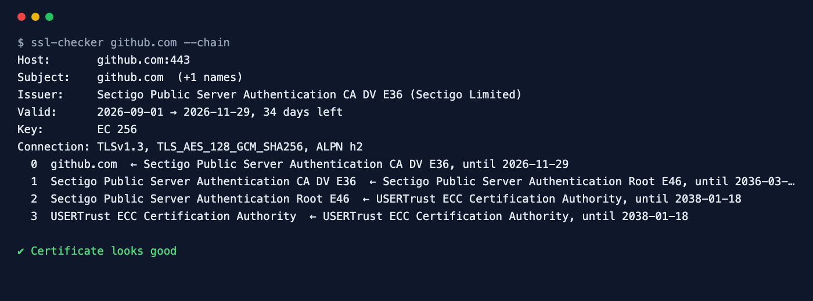

<div align="center">

# SSL Checker

**Check a site's TLS certificate before your visitors see a warning.**

[](https://github.com/ksanyok/ssl-checker/actions/workflows/ci.yml) [](LICENSE)   [](https://promopilot.link/en/tools/ssl-checker.php?utm_source=github&utm_medium=repo&utm_campaign=tools&utm_content=ssl-checker)

**[▶ Use the free online version — no install, no sign-up](https://promopilot.link/en/tools/ssl-checker.php?utm_source=github&utm_medium=repo&utm_campaign=tools&utm_content=ssl-checker)**

</div>

`ssl-checker` opens a TLS connection the way a browser does (with SNI and ALPN), reads the certificate chain the server actually sends and tells you what will go wrong and when: how many days are left, whether the certificate covers the host name (including wildcard rules), whether intermediates are missing, whether the chain is trusted at all, and which TLS version, cipher and HTTP protocol were negotiated. Point it at a list of hosts and run it daily to never miss a renewal again.



## What it checks

- Days until expiry, with a configurable warning window (default 21 days); not-yet-valid certificates
- Host name coverage by the Subject Alternative Names, with correct wildcard rules (`*.example.com` covers `www.example.com`, not `example.com` or `a.b.example.com`)
- Missing intermediate certificates — the classic "works in Chrome, fails in curl and on Android" problem
- Self-signed and otherwise untrusted chains
- RSA keys under 2048 bits
- Negotiated TLS version (deprecated TLS 1.0/1.1, TLS 1.2 vs 1.3), cipher suite and ALPN (`h2` / `http/1.1`)
- Full chain details with `--chain`: subject, issuer and expiry of every certificate the server sends

## Why it matters

An expired or mismatched certificate takes a site offline just as surely as a crashed server: browsers show a full-page warning and most visitors leave. Automated renewal reduces the risk but does not remove it — renewals fail silently when DNS, a load balancer or a firewall changes, and a server that forgets to send its intermediate certificate works in desktop browsers while failing for APIs, mobile apps and crawlers. A daily check with an early warning turns an outage into a calendar reminder.

## Quick start

```bash
# run straight from GitHub, nothing to install
npx github:ksanyok/ssl-checker example.com

# or install the CLI globally
npm install -g github:ksanyok/ssl-checker
ssl-checker example.com
```

Check several hosts and a custom port:

```bash
ssl-checker example.com api.example.com mail.example.com:993
```

Warn 30 days ahead and fail the job on warnings:

```bash
ssl-checker --file hosts.txt --warn-days 30 --strict
```

Inspect the chain the server sends:

```bash
ssl-checker example.com --chain
```

## Example output

```text
$ ssl-checker github.com --chain
Host:       github.com:443
Subject:    github.com  (+1 names)
Issuer:     Sectigo Public Server Authentication CA DV E36 (Sectigo Limited)
Valid:      2026-09-01 → 2026-11-29, 34 days left
Key:        EC 256
Connection: TLSv1.3, TLS_AES_128_GCM_SHA256, ALPN h2
  0  github.com  ← Sectigo Public Server Authentication CA DV E36, until 2026-11-29
  1  Sectigo Public Server Authentication CA DV E36  ← Sectigo Public Server Authentication Root E46, until 2036-03-21
  2  Sectigo Public Server Authentication Root E46  ← USERTrust ECC Certification Authority, until 2038-01-18
  3  USERTrust ECC Certification Authority  ← USERTrust ECC Certification Authority, until 2038-01-18

✔ Certificate looks good
```

## CLI

```text
Usage: ssl-checker <host[:port] | url> [host ...] [options]

Connects over TLS and checks the certificate: expiry, host name match, trust
chain and missing intermediates, self-signed certificates, key size and the
negotiated protocol and cipher.

Options:
  --warn-days <n>   Warn when the certificate expires within n days (default: 21)
  --file <path>     Check every host in a file (one per line)
  --chain           Print the whole certificate chain
  --json            Print JSON
  --strict          Exit with code 1 on warnings too
  -h, --help        Show this help

Online version (no install): https://promopilot.link/en/tools/ssl-checker.php
```

## Use as a library

```js
import { checkSsl } from '@promopilot/ssl-checker';

const r = await checkSsl('example.com', { warnDays: 30 });
console.log(r.certificate.issuer, r.certificate.validTo, `${r.daysLeft} days left`);
console.log(r.protocol, r.cipher, r.alpn, r.issues);
```

`checkSsl(target, { warnDays, timeout, connect, now })` accepts `host`, `host:port` or a URL and returns `{ host, port, protocol, cipher, alpn, authorized, daysLeft, certificate, chain[], issues[], ok }`. `describeCertificate(pem)` and `assessTls(facts)` work offline on any PEM. Issue codes are stable: `expired`, `expiring`, `not-yet-valid`, `name-mismatch`, `self-signed`, `incomplete-chain`, `untrusted`, `weak-key`, `old-protocol`, `no-tls13`.

## Use in CI (GitHub Actions)

Get a failed workflow (and an email from GitHub) weeks before a certificate expires:

```yaml
on:
  schedule: [{ cron: '0 7 * * *' }]
jobs:
  certificates:
    runs-on: ubuntu-latest
    steps:
      - uses: ksanyok/ssl-checker@v1
        with:
          args: example.com api.example.com --warn-days 30 --strict
```

## How it works

The tool uses Node's built-in `tls.connect` with SNI (`servername`), ALPN and `rejectUnauthorized: false`, so it can still read and explain an invalid certificate instead of just failing. The chain is collected from `getPeerCertificate(true)` and each certificate is parsed with `crypto.X509Certificate`. Trust is taken from Node's verification result against its bundled Mozilla CA store; `UNABLE_TO_VERIFY_LEAF_SIGNATURE` is reported as a missing intermediate. Host names are matched against the SANs using RFC 6125 wildcard rules.

## CLI vs. online version

| | This package | [Online tool](https://promopilot.link/en/tools/ssl-checker.php?utm_source=github&utm_medium=repo&utm_campaign=tools&utm_content=ssl-checker) |
|---|---|---|
| Runs on | Your machine, CI, cron | Any browser |
| Bulk and ports | Any number of hosts, any port | One host |
| Alerts | Exit codes, `--warn-days` | — |
| Output | Text, chain, JSON | Visual report with explanations |
| Price | Free, MIT | Free, no sign-up |


## FAQ

<details>
<summary><b>Why does my site work in the browser but fail here?</b></summary>

Usually a missing intermediate certificate. Browsers often fill the gap from cache or by downloading it; most other clients do not. Install the full chain (often `fullchain.pem`) on the server.
</details>

<details>
<summary><b>Does a wildcard certificate cover the bare domain?</b></summary>

No. `*.example.com` covers `www.example.com` and `shop.example.com` but not `example.com` and not `a.b.example.com`. Most certificates list the bare domain as a separate name.
</details>

<details>
<summary><b>Can I check non-HTTPS services like SMTP or IMAP?</b></summary>

Services with implicit TLS work with a port: `ssl-checker mail.example.com:993` or `:465`. STARTTLS (port 25/587) is not supported.
</details>

<details>
<summary><b>What warning period should I use?</b></summary>

Let's Encrypt certificates renew 30 days before expiry, so `--warn-days 21` catches a failed renewal with three weeks to spare. For yearly commercial certificates use 30–45.
</details>

<details>
<summary><b>Does it check revocation?</b></summary>

No. OCSP/CRL checks are not performed; the tool focuses on the problems that cause outages.
</details>

<details>
<summary><b>Is there a version without installing anything?</b></summary>

Yes — the [online SSL Checker](https://promopilot.link/en/tools/ssl-checker.php?utm_source=github&utm_medium=repo&utm_campaign=tools&utm_content=ssl-checker) runs the same checks in the browser and explains each result.
</details>

## Related free tools

- [Security Headers Checker](https://promopilot.link/en/tools/security-headers.php?utm_source=github&utm_medium=repo&utm_campaign=tools&utm_content=security-headers) — CSP, HSTS and other HTTP security headers
- [Redirect Checker](https://promopilot.link/en/tools/redirect-checker.php?utm_source=github&utm_medium=repo&utm_campaign=tools&utm_content=redirect-checker) — trace redirect chains, loops and status codes
- [HTTP Headers Checker](https://promopilot.link/en/tools/headers-checker.php?utm_source=github&utm_medium=repo&utm_campaign=tools&utm_content=headers-checker) — security, caching and compression headers
- [Website Status](https://promopilot.link/en/tools/website-status.php?utm_source=github&utm_medium=repo&utm_campaign=tools&utm_content=website-status) — is a site down for everyone or just you
- [MX Lookup](https://promopilot.link/en/tools/mx-lookup.php?utm_source=github&utm_medium=repo&utm_campaign=tools&utm_content=mx-lookup) — mail servers, priorities and provider detection
- [All 120+ free SEO, email and web tools](https://promopilot.link/en/tools/?utm_source=github&utm_medium=repo&utm_campaign=tools&utm_content=ssl-checker)

## Contributing

Bug reports and pull requests are welcome — see [CONTRIBUTING.md](CONTRIBUTING.md). Security issues: [SECURITY.md](SECURITY.md).
More docs live in the [wiki](https://github.com/ksanyok/ssl-checker/wiki) (sources in [docs/wiki](docs/wiki)).

## License

[MIT](LICENSE) © 2026 Alexandr Krikun

---

<sub>Built and maintained by the team behind [PromoPilot](https://promopilot.link/?utm_source=github&utm_medium=repo&utm_campaign=tools&utm_content=ssl-checker) — link building, SEO monitoring and 120+ free tools for site owners. Also on [YouTube](https://www.youtube.com/channel/UCPB8m7BgaexcZh0Vr49ViYA).</sub>
